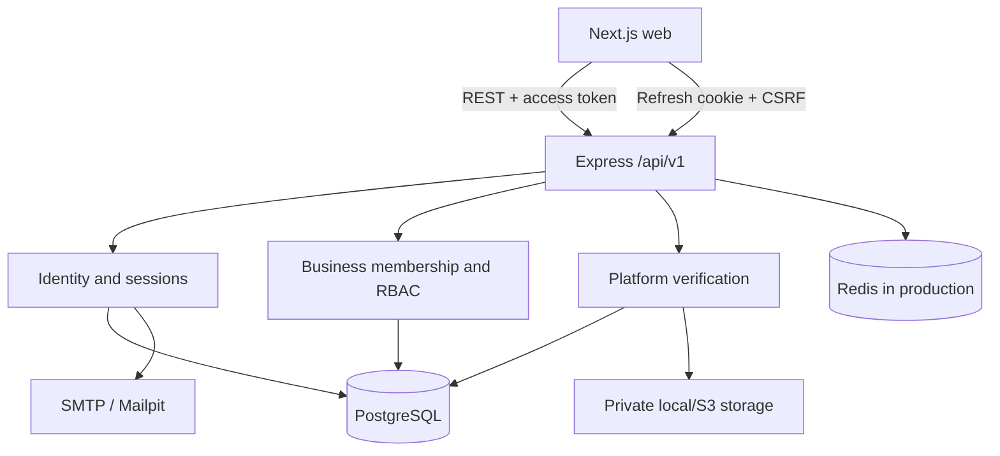

# WarrantyPass architecture

## Identity and trust boundary



Business policy remains in Express services; Next.js is a presentation client. Shared DTO and Zod
packages prevent contract drift without exposing Prisma models. Current status and permissions are
resolved server-side.

## Goals

The Part 1 architecture provides stable seams for nine later product phases without prematurely
implementing their business workflows. It prioritizes explicit trust provenance, secure document
handling, business-scoped authorization, shared API contracts, operational visibility, and separately
deployable web/API services.

## System context

```text
Browser
  │ HTTPS + JSON
  ▼
Next.js web application
  │ Versioned REST calls
  ▼
Express API ─────────► PostgreSQL
  │                       ▲
  ├──► private object     │ Prisma ORM
  │    storage (future)   │
  └──► async jobs/email (future)
```

The Next.js application owns rendering, navigation, form interaction, and client-side API state.
Express owns every core business endpoint and application rule. PostgreSQL is authoritative for
structured domain data. File binaries belong in local development storage or S3-compatible production
storage, never PostgreSQL.

## Monorepo boundaries

- `apps/web` is an App Router frontend. TanStack Query is installed at the root provider and becomes
  the standard for remote API state in later parts.
- `apps/api` is an ESM Express API. Modules contain routes, controllers, and services; infrastructure is
  reached through ports where substitution improves tests.
- `packages/shared` holds API-facing DTOs, response types, status vocabulary, permissions, and
  Bangladesh locale utilities. It intentionally does not export Prisma models.
- `packages/validation` holds shared Zod input contracts. Browser forms and API request middleware can
  consume the same schema.
- `packages/ui` provides accessible, product-agnostic presentation components backed by CSS design
  tokens.
- configuration packages make TypeScript and lint behavior consistent across workspaces.

Workspace packages compile to ESM `dist` output. Turborepo builds dependencies before applications,
which keeps production runtime imports independent of TypeScript loaders.

## Backend module shape

```text
modules/<domain>/
├── <domain>.routes.ts       # URL and middleware composition only
├── <domain>.controller.ts   # HTTP translation
├── <domain>.service.ts      # application use cases
├── <domain>.repository.ts   # persistence port/adapter where useful
└── <domain>.schemas.ts      # domain-specific request contracts
```

Controllers stay thin. Services receive required ports in constructors. Repository abstraction is added
where a module has business persistence behavior; a generic repository layer is deliberately avoided.
The health module demonstrates the intended dependency-injection pattern.

## Key decisions

### Express remains the domain API

Next.js Server Actions are not used for business logic. This keeps API behavior independently testable,
versioned, and available to future mobile or partner clients.

### Warranty provenance is stored, not inferred from styling

`Warranty.source`, `issuerBusinessId`, and `verificationLabel` distinguish business-issued and
user-uploaded records. The UI uses a central status-badge system. A manual upload never receives a
business verification label.

### Memberships and roles are data-driven

`BusinessMember` links users to businesses and roles. A user may have one membership per business and
many memberships overall. `Role` supports immutable-key system templates and future business-scoped
custom roles; permissions are normalized through `RolePermission`. Roles are therefore not a permanent
TypeScript enum.

### DTOs are independent of the ORM

The Prisma Client is backend-only generated code. Shared DTOs use API names and ISO strings rather than
database types. This prevents schema changes from silently becoming public contracts.

### Prisma 7 uses the PostgreSQL driver adapter

The generated client is explicit and ESM-native. `@prisma/adapter-pg` owns connection pooling, and one
long-lived `PrismaClient` is created for the API process. Startup connects before listening and graceful
shutdown drains the HTTP server before disconnecting.

### Operational endpoints do not expose secrets

Health responses expose service name, release version, time, uptime, and database latency only. They do
not return configuration, connection strings, hostnames, or exception messages.

### Document storage is private by default

The storage port is provider-neutral. Production adapters will issue short-lived signed URLs after
authorization and ownership checks. Metadata and object keys live in PostgreSQL; bytes do not.

## Frontend architecture and accessibility

The App Router uses Server Components by default and Client Components only for interaction, forms,
query state, dialogs, menus, and navigation drawers. CSS custom properties define light/dark design
tokens. Tailwind utilities consume those tokens without encoding domain colors into page components.

The foundation includes:

- a mobile-first layout and responsive navigation;
- keyboard-visible focus, skip navigation, semantic sections, native controls, and reduced-motion rules;
- status information expressed as words as well as color;
- a font stack ready for future Bangla content;
- `Asia/Dhaka`, `en-BD`, and `BDT` shared formatting utilities;
- meaningful loading, empty, error, not-found, and global recovery states.

## Scalability path

The first scale boundary is independent horizontal scaling of `web` and `api`. PostgreSQL connection
pool settings must match instance count. Later high-latency work—document malware scanning, email/SMS,
recall fan-out, scheduled expiry notifications, and exports—belongs in a durable job queue with an
outbox pattern. Read replicas, cache layers, and search infrastructure should be added only after
measured need.

## Deferred deliberately

Part 2 will add real authentication, secure session rotation, CSRF policy, email verification, account
recovery, business application submission, and authorization middleware. Later phases add domain
modules, payment providers, upload adapters, background jobs, localization, observability exporters,
and deployment IaC.
