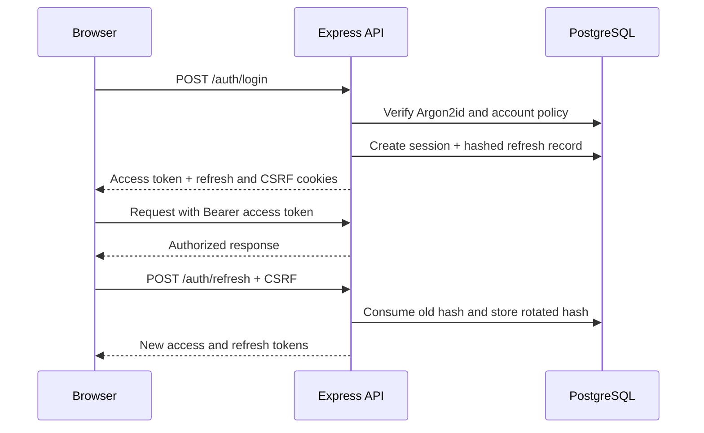

# Authentication and session lifecycle

WarrantyPass uses short-lived signed access tokens and rotating opaque refresh tokens. Access
tokens remain in browser memory. Refresh tokens are hashed before storage and delivered in an
`HttpOnly`, `Secure` (production), same-site cookie. A readable CSRF cookie must match
`X-CSRF-Token` on cookie-authenticated mutations.

Refresh-token reuse revokes the complete session family. Password reset revokes every session;
password change preserves only the current session. Logout is idempotent. Users can inspect and
revoke device sessions using browser/OS, masked IP, last activity, and expiry hints.

Registration and recovery tokens are random, single-use, time-limited, and stored only as hashes.
Generic resend/recovery responses reduce account enumeration. Login uses dummy hash verification
for missing accounts, generic credential errors, throttling, and timed lockouts.

Passwords support 12–128-character passphrases and configurable Argon2id costs. The local
compromised-password denylist is a foundation; production should add a privacy-preserving breached
password service.
