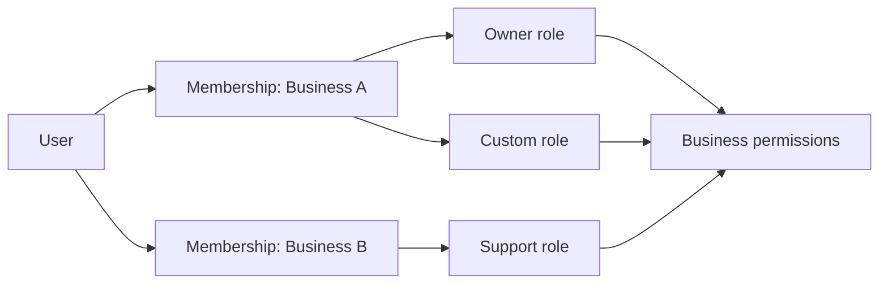

# Authorization model

Authorization is resolved by Express for every request. Browser checks improve usability but are
never treated as security controls.

Business access is tenant-scoped. `X-Business-ID` identifies the requested workspace; middleware
confirms an active membership and loads all assigned roles and permissions. Users can belong to
multiple businesses with different roles.

System roles are protected templates; custom roles are database records. A manager may grant only
permissions they already possess, preventing privilege escalation. The final active owner cannot
be removed or suspended.

Platform administration uses separate role, permission, assignment, and middleware tables.
Business ownership never grants platform powers. Sensitive decisions require explicit platform
permissions and create audit events.
