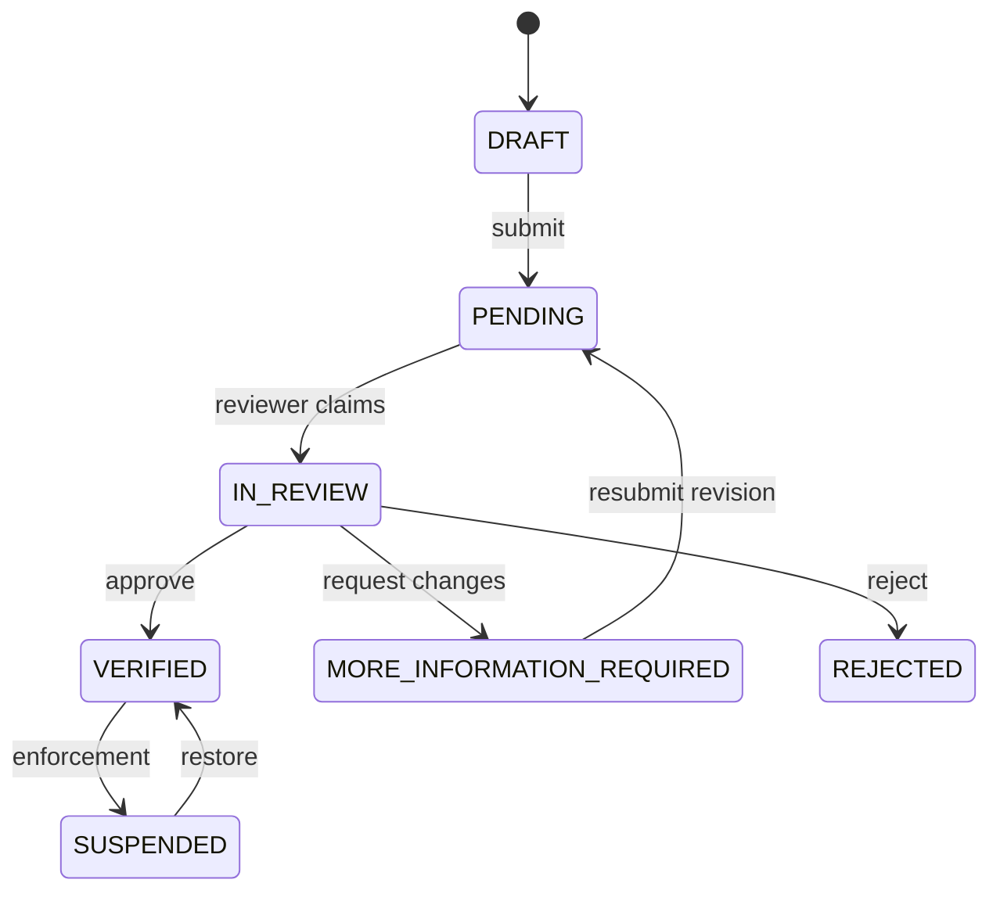

# Business verification workflow

Registration creates an unverified owner, a `DRAFT` business, owner membership, and editable
revision. Verification is always a deliberate platform decision.

Trade Licence and BIN remain structured searchable fields. Duplicates raise a review flag rather
than merging businesses. `statusVersion` prevents stale writes. Resubmission creates a new
immutable revision and status history separates applicant-visible reasons from internal notes.

Documents are private objects. Local storage uses collision-resistant keys and restricted file
permissions; S3-compatible storage requests server-side encryption and supports signed URLs.
Upload handling checks size, detected MIME type, checksum, ownership, revision, and scan state.
Production must connect the quarantine state to malware scanning before marking files `SAFE`.
